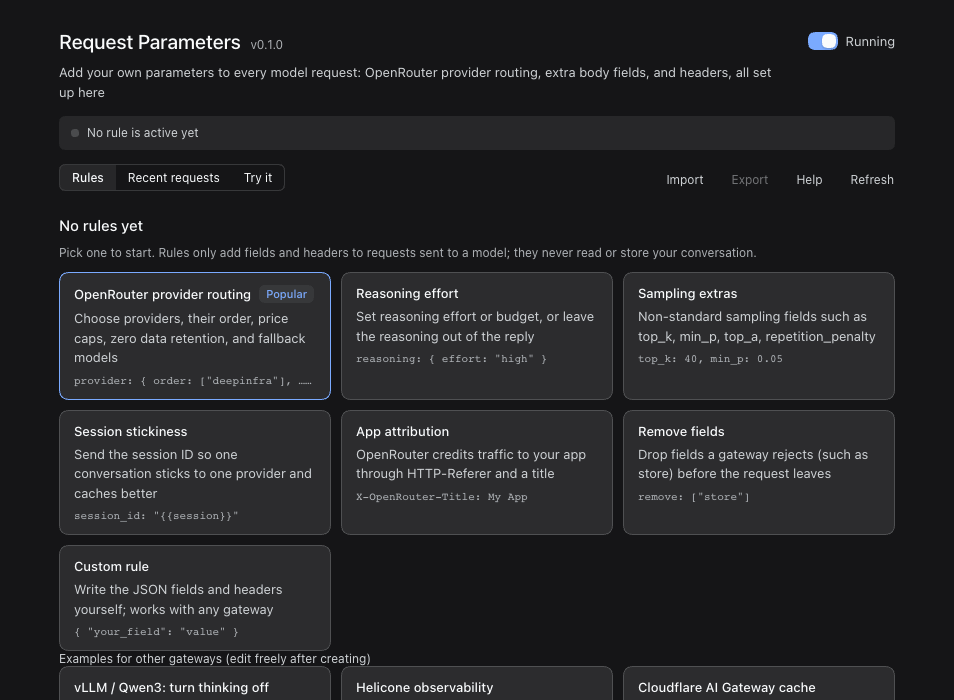
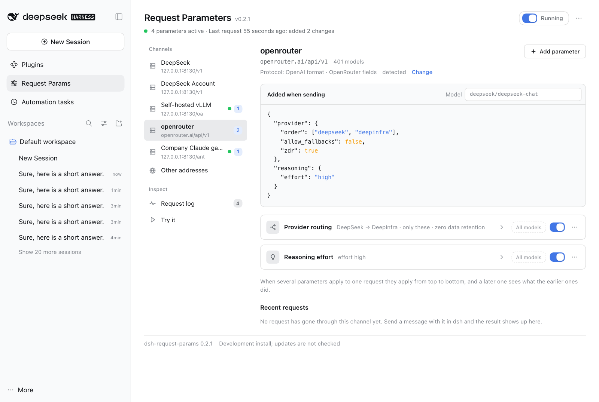
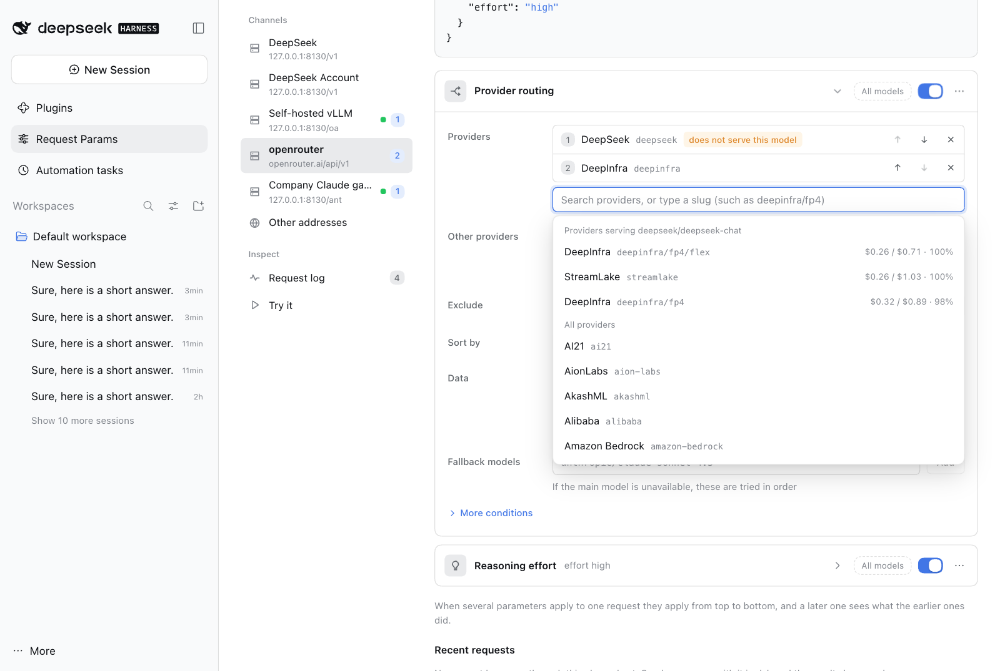
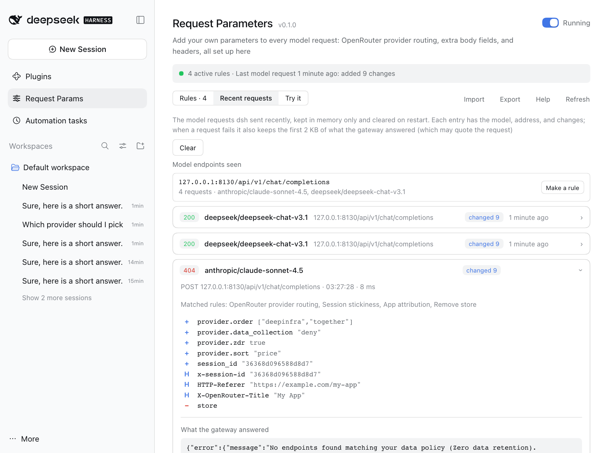
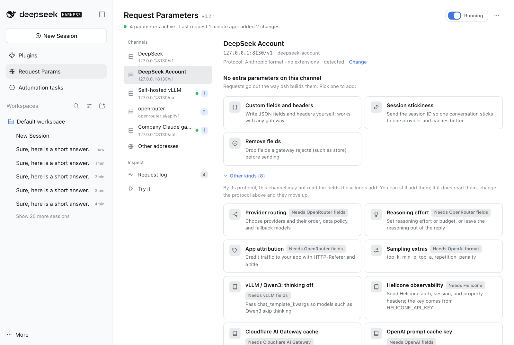
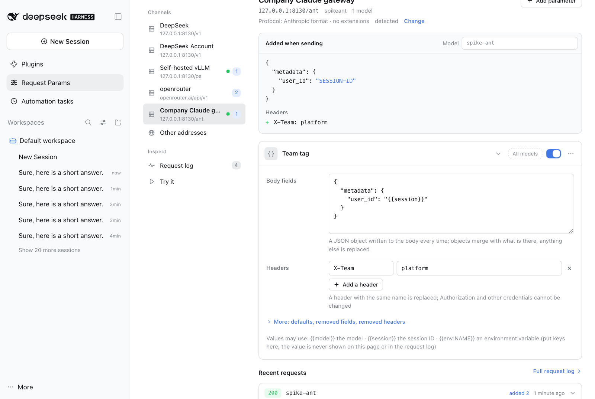

# Request Parameters (dsh-request-params)

English | [中文](README.zh.md)

**Add your own parameters to every model request [dsh](https://github.com/deepseek-ai/deepseek-harness) sends.** OpenRouter provider routing, fallback models, reasoning effort, sampling extras, gateway headers, or any JSON field a gateway accepts. Pick one of the channels dsh already has, add parameters on a page instead of in code, see exactly what each request will carry before anything is sent, and see what the gateway answered afterwards.

<p align="center">
  
</p>

## Why

dsh sends the fields its model adapters know about. Gateways such as [OpenRouter](https://openrouter.ai) take more: which providers to use and in what order, fallback models, a reasoning budget, a session ID for cache affinity. dsh does not send OpenRouter's `provider` routing preferences. Plugins exist for single slices of this (provider order and quantization, for example); this one is general. The same page handles any field or header for any gateway, with a ready form for OpenRouter's routing options, a live preview, and a log.

Each *parameter* belongs to a channel (or names its own hosts, models, and paths) and says what to add, replace, or remove in the body and headers. Parameters are applied to the request just before it leaves dsh; in the rules file each one is a *rule*.

## Highlights

- **Organized by channel.** The page lists the model channels dsh is set up with (the official DeepSeek route and every `llm-pi-ai` route) and the address each one sends to. Open a channel to see its parameters and add one in a click; it is matched to that channel for you. Parameters for any other address are under **Other addresses**.
- **See what will be sent.** **Added when sending** shows, as JSON, what the channel's parameters add to a request for the model you pick, including unsaved edits. Nothing is sent.
- **Pick providers, do not hand-write JSON.** **Provider routing** is one list: search providers (the ones that serve the previewed model come first, with price and uptime), put them in order, decide whether other providers may be used, exclude some, sort, require zero data retention, add fallback models; price caps, quantization, an allow list, and speed preferences are under **More conditions**. A provider that does not serve the model is flagged, and a list that would fail with "No endpoints found" is called out before you save.
- **See what happened after.** Each channel shows its recent requests: the status, what was added, and, when the gateway refused, what it said. **Request log** has every model request dsh sent.
- **Safe by default.** Core fields (`messages`, `tools`, `model`, …) and credential headers (`Authorization`, `x-api-key`, …) cannot be changed. Secrets come from environment variables (`{{env:NAME}}`) and are never shown. If something goes wrong while applying a parameter, the request goes out unchanged instead of failing.
- **One hook for the usual routes.** The official DeepSeek endpoint and the OpenAI-compatible and Anthropic-compatible routes of `llm-pi-ai` (OpenRouter, a self-hosted vLLM, an enterprise gateway) all go through the same `fetch` hook; see Compatibility for what was verified.
- **Updates in one click.** The page tells you when a newer version of this plugin is out and installs it with DSH's own installer after you confirm.
- **Everyday comforts.** A switch pauses everything at once. Unsaved edits survive leaving the page, and Ctrl/⌘ + S saves. Deleting can be undone. A rules file changed elsewhere is detected instead of overwritten. Parameters export to and import from JSON. English and Chinese, light and dark, down to phone width.

<p align="center">
  <picture>
    <source media="(prefers-color-scheme: dark)" srcset="docs/screenshots/overview-dark.png">
    
  </picture>
</p>

<p align="center">
  <picture>
    <source media="(prefers-color-scheme: dark)" srcset="docs/screenshots/routing-dark.png">
    
  </picture>
</p>

## Install

```bash
dsh plugin --profile web add dsh-request-params
```

If you run dsh from source, use `pnpm dsh plugin --profile web add dsh-request-params`. Restart `dsh web` afterwards. A **Request Params** entry appears in the sidebar below **Plugins**.

To try a checkout, use `link:/path/to/dsh-request-params` instead of the name.

## Quick start: OpenRouter in two minutes

1. **Route dsh to OpenRouter** if you have not yet. In `llm-pi-ai`, `openrouter` is a built-in provider; it only needs a key, kept in an environment variable:

   ```yaml
   - name: '@deepseek-ai/dsh-llm-pi-ai'
     config:
       providers:
         openrouter:
           apiKeyEnv: OPENROUTER_API_KEY
   ```

   Pick an OpenRouter model in the composer.
2. Open **Request Params** and pick the **openrouter** channel. Click **Provider routing**, type a provider such as `deepseek` and press Enter, set **Other providers** to **Never** if no other provider may serve the request, and press **Save** (or Ctrl/⌘ + S). **Added when sending** shows the `provider` object; put the model you use in its **Model** box, and if a provider is flagged as not serving it, pick another provider or model.
3. Send a message. The channel's **Recent requests** shows what was added and the gateway's status.

<p align="center">
  <picture>
    <source media="(prefers-color-scheme: dark)" srcset="docs/screenshots/requests-dark.png">
    
  </picture>
</p>

## What you can add

| Kind | Adds | Typical use |
|---|---|---|
| **Provider routing** | `provider` (`order`, `only`, `ignore`, `allow_fallbacks`, `require_parameters`, `data_collection`, `zdr`, `quantizations`, `sort`, `max_price`, `preferred_min_throughput`, `preferred_max_latency`, `enforce_distillable_text`) and `models` | Choose providers and order, cap the price, require zero data retention, fall back to other models |
| **Reasoning effort** | `reasoning` (`effort`, `max_tokens`, `exclude`) | Turn thinking up or down, or keep it out of the reply |
| **Sampling extras** | `top_k`, `min_p`, `top_a`, `repetition_penalty` | Sampling fields the standard API does not have |
| **Session stickiness** | `session_id` in the body and the `x-session-id` header | Keep one conversation on one provider so caches hit |
| **App attribution** | `HTTP-Referer` and `X-OpenRouter-Title` headers | Credit your traffic to your app on OpenRouter (dsh does not send these) |
| **Remove fields** | removes fields such as `store` | A gateway that rejects a field dsh sends |
| **Custom fields and headers** | anything: JSON fields, headers, removals | Any other gateway |

An OpenRouter channel offers every kind. Other channels offer the kinds that are not OpenRouter-specific, plus examples for other gateways: turn thinking off on a self-hosted vLLM (`chat_template_kwargs`), Helicone headers, Cloudflare AI Gateway cache headers, and an OpenAI `prompt_cache_key`. Each example is an ordinary custom parameter you can edit. **Other addresses** offers everything.

<p align="center">
  <picture>
    <source media="(prefers-color-scheme: dark)" srcset="docs/screenshots/add-dark.png">
    
  </picture>
</p>

## Writing your own parameter

**Custom fields and headers** has these parts:

- **Body fields**: a JSON object merged into the body. Objects merge with what is there; anything else is replaced.
- **Headers**: added to the request; a header of the same name is replaced.
- Under **More**: **Defaults** (like body fields, but a field the request already has is left alone), **Remove fields** (dotted paths such as `store` or `stream_options.include_usage`; removal happens first, then fields are set), **Remove headers**, and **Allow changing core fields**.

Every parameter has a scope. On a channel, **All models** limits it to some of the channel's models (`deepseek/*`, `*-chat`), and **Edit hosts and paths** in its menu shows the address it matches. Under **Other addresses** a parameter names its own *hosts* (`openrouter.ai`, `*.example.com`, `127.0.0.1:8130`), optional *models*, and optional *paths* (prefix). Without a path, it reaches model endpoints only (`…/chat/completions`, `…/messages`, `…/responses`, `…:generateContent`); name a path to reach another endpoint.

When several parameters apply to one request they run from top to bottom, and a later one sees the result of the earlier ones. Values may use `{{model}}` (the request's model), `{{session}}` (the dsh session ID; for routes where dsh sends none, a stable key derived from the conversation), and `{{env:NAME}}` (an environment variable; if it is not set the field is skipped and the log says so).

<p align="center">
  <picture>
    <source media="(prefers-color-scheme: dark)" srcset="docs/screenshots/custom-dark.png">
    
  </picture>
</p>

## Safety and privacy

- `messages`, `system`, `tools`, `tool_choice`, `input`, `instructions`, `prompt`, `contents`, `stream`, and `model` cannot be set or removed unless a custom parameter explicitly allows it.
- `Authorization`, `x-api-key`, `api-key`, `x-goog-api-key`, `Cookie`, `Host`, and the headers that frame the request (`Content-Length`, `Content-Type`, …) can never be changed.
- A parameter with a problem is not applied, and the page shows what is wrong. If applying parameters fails while a request is being sent, the request goes out unchanged and the log says so.
- Parameters are stored on your machine in `<profile>/.dsh-request-params/config.json`. Nothing is sent anywhere because of them.
- The request log lives in memory only (the last 50 requests; cleared on restart). It holds the model, the address, and the changes made; for a failed request it also keeps the first 2 KB of the gateway's answer, which can quote the request. It never holds the conversation itself. Values from environment variables appear as "not shown", and are replaced with `[env]` if the gateway's answer quotes them.
- The channel list comes from dsh's own channel list and settings (with secrets redacted), to show each channel's address and models; the page changes nothing there and stores nothing.
- The page reaches the network for two things. OpenRouter's public catalog (`/providers`, `/models`, `/models/{id}/endpoints`) is read only while the page shows a provider routing parameter: the provider list, the providers that serve the previewed model, and fallback model suggestions; the provider list also works offline from a built-in copy. The update check asks the npm registry DSH is configured with for this plugin's latest version (see Updates). Neither sends a key or any content.

## The rules file

The page reads and writes `<profile>/.dsh-request-params/config.json`. You can also edit it by hand: the next model request uses the new rules, and an open page loads them within a few seconds (or, if it has unsaved edits, asks what to do).

```json
{
  "version": 1,
  "revision": 3,
  "enabled": true,
  "rules": [
    {
      "id": "r1a2b3c4d",
      "name": "OpenRouter: DeepInfra first",
      "enabled": true,
      "match": { "hosts": ["openrouter.ai"], "paths": [], "models": ["deepseek/*"] },
      "body": {
        "merge": { "provider": { "order": ["deepinfra", "together"], "sort": "price" } },
        "defaults": {},
        "remove": ["store"]
      },
      "headers": { "set": { "X-OpenRouter-Title": "My App" }, "remove": [] },
      "allowProtected": false
    }
  ]
}
```

- `revision` counts saves. A page that saves over a newer revision is stopped and asked what to do.
- A rule may also carry `note` (free text) and `preset` (`{ "id", "form" }`, the form the page reopens). A `preset` that no longer builds exactly this rule's `body` and `headers` is dropped, and the rule stays as a custom rule.
- Fields the page does not know, and values of the wrong type, are dropped when the file is read. A file that is not valid JSON is reported on the page and left untouched; **Move it aside and start fresh** renames it.
- **Export** writes the same object without `revision`. **Import** accepts that object or a bare array of rules.

## How it works

dsh's model adapters send requests through the global `fetch`. This plugin wraps `fetch` once. For a POST request with a JSON body that looks like a model call (or that a rule names), it reads the body, applies the matching rules, and sends the changed request; every other request passes through untouched. Responses and streams are never read or changed (only the status, and a failed response's first 2 KB, are noted for the log). Uninstalling the plugin or pausing it puts everything back to what dsh sends by itself.

## When a parameter does not seem to apply

1. Open the channel. **Added when sending** shows what its parameters add for the model in the **Model** box. If it says no parameter applies to this model, check the parameter's model scope (the **All models** button).
2. Look at the channel's **Recent requests**, or the **Request log**. If the request is not there, the model request did not go through `fetch` (or no message has been sent since the last restart).
3. Open the request. **No parameters** means the host, model, or path differs from every parameter. A host without a port matches any port; write `127.0.0.1:8130` to match one.
4. **Nothing to change** means the request already had those values.
5. A note that a parameter *has problems* or *uses an environment variable that is not set* says what to fix.
6. If the gateway answers 4xx, open the request: the fields that were added are listed with the gateway's own message. **Pause all parameters** shows whether they are the cause. For OpenRouter, "No endpoints found" usually means the providers you allowed do not serve that model; the routing form flags them for the model in the preview.

## Compatibility and limits

- Needs dsh with the web client and Node `^22.19.0 || >=24`. Tested with dsh 0.2.1-rc.2.
- Verified against real dsh runs on three routes: the official DeepSeek endpoint (`/v1/messages`), an OpenAI-compatible `llm-pi-ai` route (`/chat/completions`), and an Anthropic-compatible `llm-pi-ai` route (`/v1/messages`).
- Applies to requests sent through the global `fetch`. A provider that captured its own `fetch` earlier would not be seen; the request log shows what the plugin saw.
- A gateway may ignore or reject fields it does not know. OpenRouter ignores unsupported parameters unless `require_parameters` is on.
- Limits: 100 parameters; per parameter, 64 KB of JSON each for the body fields and the defaults, and 40 headers.

## Uninstall

```bash
dsh plugin --profile web remove dsh-request-params
```

Requests go back to what dsh sends by itself. The parameters stay in `<profile>/.dsh-request-params/config.json`, so installing again brings them back; delete the folder to clean up.

## Updates

The page checks for a newer version of this plugin and can install it.

- **Check**: when you open the page, the plugin asks the npm registry DSH is configured with (a mirror works) for the latest version of `dsh-request-params`, at most once every 12 hours. The request names only the package. Turn it off with **Check for updates automatically** at the bottom of the page; **Check for updates** there and in the **⋯** menu still works. Development installs (`link:`) are never checked.
- **Upgrade**: a banner at the top shows a newer release with **See what changed** and **Upgrade…**. After you confirm, DSH's own installer downloads that release's tarball from the registry and installs it, with progress and **Cancel install**. The installer restores the profile's files when an install fails or is cancelled, and the banner then shows the installer's message and the command to upgrade by hand. Only the `latest` release is offered, never a prerelease, and the tarball address must be this package's file on the registry that answered.
- **After the upgrade**: depending on the DSH version, the new version takes over at once (this page closes; open it again) or loads when you restart dsh (web: run `dsh web` again; desktop app: quit and reopen). The next time you open the page it says **Upgraded to** the new version. Your parameters stay, and running sessions are not affected. The banner shows the command that goes back to the old version.
- **Installed from GitHub**: the banner shows `dsh plugin --profile web add github:xiaohai-78/dsh-request-params` instead of a button.
- **By hand**: run `dsh plugin --profile web add dsh-request-params@latest`, or on the Plugins page use **Add plugin** with `https://registry.npmjs.org/dsh-request-params/-/dsh-request-params-<version>.tgz`. Without `@latest` the command does nothing, because DSH keeps the version it installed.
- **From 0.1.0**: 0.1.0 has no update check; upgrade it by hand once.

## Development

| File | Role |
|---|---|
| `index.js` | Host plugin: wraps `fetch`, serves `POST /api/dsh-request-params` (`get`, `save`, `check`, `dryRun`, `preset`, `recent`, `clearRecent`, `resetDamaged`, `channels`, `orProviders`, `orModels`, `orEndpoints`, and the update actions `updateStatus`, `setUpdateCheck`, `dismissUpgraded`, `upgrade`, `upgradeStatus`, `cancelUpgrade`), reloads the rules when the file changes |
| `rules.js` | Rule engine: validation, host/model/path matching, templates, applying rules to a body and headers |
| `interceptor.js` | The `fetch` wrapper and the request log |
| `presets.js` | Preset forms and the rules they build |
| `config-store.js` | Rules file with atomic writes and revision checks |
| `channels.js` | Reads the configured channels from dsh's `llm` and `settings` services and works out each one's endpoint |
| `update.js` | Version check helpers without DSH services: version comparison, how the profile depends on the package, the registries to ask, and the check that the registry's tarball address is this package's file on that registry |
| `self-update.js` | The update actions: the check with its 12-hour cache, the switch and the note an upgrade leaves in `<profile>/.dsh-request-params/settings.json`, and the install through DSH's plugin manager (`installBundle`, `cancelInstall`, the `plugin-manager/install-state` progress) |
| `openrouter.js` | OpenRouter catalog client with cache and offline fallback; `openrouter-providers.json` is the built-in provider list |
| `client.js` | The web page (English and Chinese): channel list, preview, parameter cards, request log, dry run |
| `test/` | `node --test` suites; `test/fixtures/` holds trimmed OpenRouter catalog answers |

### Verification

```bash
npm test
```

runs 107 tests with `node --test`: the rule engine, the `fetch` wrapper (chain safety, bodies as strings, bytes, or `Request`, error capture), presets, the rules file, the catalog client, reading the configured channels, the host actions, the page's matching of parameters and requests to channels and its preview and summaries, the update check and upgrade, that the package publishes every module it imports, and that both languages of the page have the same text. The page and the hook were also run end to end against real dsh processes with a local mock model server: all three routes above, parameters added per channel and seen in the requests that went out, the preview, provider search and the not-serving flag, saving, pausing, undo, import and export, a rules file changed elsewhere, and light, dark, narrow, and phone layouts. Updating was checked against the real npm registry on dsh 0.2.1-rc.2: a copy labelled 0.0.9 found 0.1.0, **Upgrade…** installed it through DSH's installer, the profile then depended on the 0.1.0 tarball, and the new version took over without a restart; installing the same release again reported it as installed and waiting for a restart. Screenshots in this README come from that setup; the OpenRouter catalog in them is OpenRouter's public one, and no request was sent to OpenRouter.

## Changes

See [CHANGELOG.md](CHANGELOG.md).

## License

MIT
