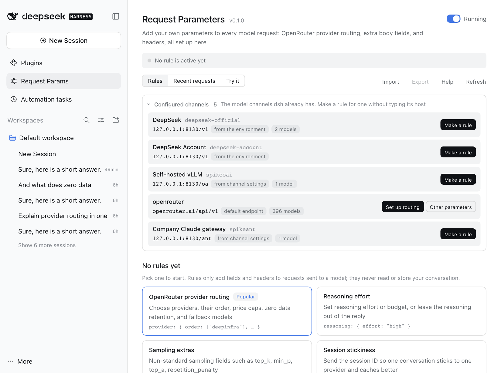

# Request Parameters (dsh-request-params)

English | [中文](README.zh.md)

**Add your own parameters to every model request [dsh](https://github.com/deepseek-ai/deepseek-harness) sends.** OpenRouter provider routing, fallback models, reasoning effort, sampling extras, gateway headers, or any JSON field a gateway accepts. Set it up on a page instead of in code, preview the exact change before anything is sent, and see what the gateway answered afterwards.

<p align="center">
  
</p>

## Why

dsh sends the fields its model adapters know about. Gateways such as [OpenRouter](https://openrouter.ai) take more: which providers to use and in what order, fallback models, a reasoning budget, a session ID for cache affinity. dsh does not send OpenRouter's `provider` routing preferences. Plugins exist for single slices of this (provider order and quantization, for example); this one is general. The same page handles any field or header for any gateway, with a ready form for OpenRouter's routing options, a preview, and a log.

A *rule* says which requests it is for (host, model, path) and what to add, replace, or remove in the body and headers. Rules are applied to the request just before it leaves dsh.

## Highlights

- **Start from the channels you already have.** **Configured channels** lists the model channels dsh is set up with (the official DeepSeek route and every `llm-pi-ai` route), with the endpoint each one sends to and its models. **Make a rule** starts a rule that already points at that channel; an OpenRouter channel gets **Set up routing** in one click.
- **Pick providers, do not hand-write JSON.** The OpenRouter preset is a form: provider order, only/never lists, fallbacks on or off, zero data retention, sort by price or speed, price caps, quantization, fallback models. **See which providers serve a model** lists every provider for a model ID with price, context, and uptime from OpenRouter's public catalog, and adds one to your lists with a click.
- **See the change before you send it.** **Try it** runs your rules (even unsaved ones) on a sample request and shows a diff of the body and the header changes. Nothing is sent.
- **See what happened after.** **Recent requests** shows each model request dsh sent: whether a rule changed it, every field it set or removed, the HTTP status, and, when the gateway refused, what it said. A rule that did not match says so, and why.
- **Safe by default.** Core fields (`messages`, `tools`, `model`, …) and credential headers (`Authorization`, `x-api-key`, …) cannot be changed. Secrets come from environment variables (`{{env:NAME}}`) and are never shown. If something goes wrong while applying a rule, the request goes out unchanged instead of failing.
- **One hook for the usual routes.** The official DeepSeek endpoint and the OpenAI-compatible and Anthropic-compatible routes of `llm-pi-ai` (OpenRouter, a self-hosted vLLM, an enterprise gateway) all go through the same `fetch` hook; see Compatibility for what was verified.
- **Everyday comforts.** A switch pauses every rule at once. Unsaved edits survive leaving the page. Deleting a rule can be undone. A rules file changed elsewhere is detected instead of overwritten. Rules export to and import from JSON. English and Chinese, light and dark.

<p align="center">
  <picture>
    <source media="(prefers-color-scheme: dark)" srcset="docs/screenshots/routing-dark.png">
    
  </picture>
</p>

<p align="center">
  <picture>
    <source media="(prefers-color-scheme: dark)" srcset="docs/screenshots/channels-dark.png">
    
  </picture>
</p>

## Install

```bash
dsh plugin --profile web add dsh-request-params
```

If you run dsh from source, use `pnpm dsh plugin --profile web add dsh-request-params`. Restart `dsh web` afterwards. A **Request Params** entry appears in the sidebar below **Plugins**.

To try a checkout, use `link:/path/to/dsh-request-params` instead of the name.

## Quick start: OpenRouter in two minutes

1. **Route dsh to OpenRouter** if you have not yet. In `llm-pi-ai`, `openrouter` is a built-in provider; it only needs a key, kept in an environment variable:

   ```yaml
   - name: '@deepseek-ai/dsh-llm-pi-ai'
     config:
       providers:
         openrouter:
           apiKeyEnv: OPENROUTER_API_KEY
   ```

   Pick an OpenRouter model in the composer.
2. Open **Request Params**. Under **Configured channels**, press **Set up routing** on the OpenRouter channel (or click **OpenRouter provider routing** below and keep `openrouter.ai` as the host), type a provider such as `deepinfra` under **Provider order** (or open **See which providers serve a model** and press **Add to order**), choose **Price** under **Sort by**, and press **Save**.
3. Send a message. Open **Recent requests** to see the `provider` object that went out.

<p align="center">
  <picture>
    <source media="(prefers-color-scheme: dark)" srcset="docs/screenshots/requests-dark.png">
    
  </picture>
</p>

## What you can add

| Preset | Adds | Typical use |
|---|---|---|
| **OpenRouter provider routing** | `provider` (`order`, `only`, `ignore`, `allow_fallbacks`, `require_parameters`, `data_collection`, `zdr`, `quantizations`, `sort`, `max_price`, `preferred_min_throughput`, `preferred_max_latency`, `enforce_distillable_text`) and `models` | Choose providers and order, cap the price, require zero data retention, fall back to other models |
| **Reasoning effort** | `reasoning` (`effort`, `max_tokens`, `exclude`) | Turn thinking up or down, or keep it out of the reply |
| **Sampling extras** | `top_k`, `min_p`, `top_a`, `repetition_penalty` | Sampling fields the standard API does not have |
| **Session stickiness** | `session_id` in the body and the `x-session-id` header | Keep one conversation on one provider so caches hit |
| **App attribution** | `HTTP-Referer` and `X-OpenRouter-Title` headers | Credit your traffic to your app on OpenRouter (dsh does not send these) |
| **Remove fields** | removes fields such as `store` | A gateway that rejects a field dsh sends |
| **Custom rule** | anything: JSON fields, headers, removals | Any other gateway |

Examples for other gateways are one click away in **New rule**: turn thinking off on a self-hosted vLLM (`chat_template_kwargs`), Helicone headers, Cloudflare AI Gateway cache headers, and an OpenAI `prompt_cache_key`. Each is an ordinary custom rule you can edit.

## Writing your own rule

A custom rule has these parts:

- **Applies to**: *hosts* (required, `openrouter.ai`, `*.example.com`, `127.0.0.1:8130`), optional *models* (`deepseek/*`, `*-chat`), optional *paths* (prefix). Without a path, a rule reaches model endpoints only (`…/chat/completions`, `…/messages`, `…/responses`, `…:generateContent`); name a path to reach another endpoint.
- **Fields to always set**: a JSON object merged into the body. Objects merge with what is there; anything else is replaced.
- **Fields to set only when missing**: the same, but a field the request already has is left alone.
- **Fields to remove**: dotted paths such as `store` or `stream_options.include_usage`. Removal happens first, then the fields are set.
- **Headers**: to add (a header of the same name is replaced) and to remove.

Rules run from top to bottom, and a later rule sees the result of the earlier ones. Values may use `{{model}}` (the request's model), `{{session}}` (the dsh session ID; for routes where dsh sends none, a stable key derived from the conversation), and `{{env:NAME}}` (an environment variable; if it is not set the field is skipped and the log says so).

## Safety and privacy

- `messages`, `system`, `tools`, `tool_choice`, `input`, `instructions`, `prompt`, `contents`, `stream`, and `model` cannot be set or removed unless a custom rule explicitly allows it.
- `Authorization`, `x-api-key`, `api-key`, `x-goog-api-key`, `Cookie`, `Host`, and the headers that frame the request (`Content-Length`, `Content-Type`, …) can never be changed.
- A rule with a problem is not applied, and the page shows what is wrong. If applying rules fails while a request is being sent, the request goes out unchanged and the log says so.
- Rules are stored on your machine in `<profile>/.dsh-request-params/config.json`. Nothing is sent anywhere because of them.
- **Recent requests** lives in memory only (the last 50 requests; cleared on restart). It holds the model, the address, and the changes made; for a failed request it also keeps the first 2 KB of the gateway's answer, which can quote the request. It never holds the conversation itself. Values from environment variables appear as "not shown", and are replaced with `[env]` if the gateway's answer quotes them.
- **Configured channels** reads dsh's own channel list and settings (with secrets redacted) to show each channel's endpoint and models; it changes nothing there and stores nothing.
- The only network access is **See which providers serve a model**, which reads OpenRouter's public catalog (`/providers`, `/models`, `/models/{id}/endpoints`). It sends no key and no content, and the provider list also works offline from a built-in copy.

## The rules file

The page reads and writes `<profile>/.dsh-request-params/config.json`. You can also edit it by hand: the next model request uses the new rules, and an open page loads them within a few seconds (or, if it has unsaved edits, asks what to do).

```json
{
  "version": 1,
  "revision": 3,
  "enabled": true,
  "rules": [
    {
      "id": "r1a2b3c4d",
      "name": "OpenRouter: DeepInfra first",
      "enabled": true,
      "match": { "hosts": ["openrouter.ai"], "paths": [], "models": ["deepseek/*"] },
      "body": {
        "merge": { "provider": { "order": ["deepinfra", "together"], "sort": "price" } },
        "defaults": {},
        "remove": ["store"]
      },
      "headers": { "set": { "X-OpenRouter-Title": "My App" }, "remove": [] },
      "allowProtected": false
    }
  ]
}
```

- `revision` counts saves. A page that saves over a newer revision is stopped and asked what to do.
- A rule may also carry `note` (free text) and `preset` (`{ "id", "form" }`, the form the page reopens). A `preset` that no longer builds exactly this rule's `body` and `headers` is dropped, and the rule stays as a custom rule.
- Fields the page does not know, and values of the wrong type, are dropped when the file is read. A file that is not valid JSON is reported on the page and left untouched; **Move it aside and start fresh** renames it.
- **Export** writes the same object without `revision`. **Import** accepts that object or a bare array of rules.

## How it works

dsh's model adapters send requests through the global `fetch`. This plugin wraps `fetch` once. For a POST request with a JSON body that looks like a model call (or that a rule names), it reads the body, applies the matching rules, and sends the changed request; every other request passes through untouched. Responses and streams are never read or changed (only the status, and a failed response's first 2 KB, are noted for the log). Uninstalling the plugin or pausing it puts everything back to what dsh sends by itself.

## When a rule does not seem to apply

1. Open **Recent requests**. If the request is not there, the model request did not go through `fetch` (or no message has been sent since the last restart).
2. Open the request. **No rule matched** means the host, model, or path differs: compare them with the rule's **Applies to**. A host without a port matches any port; write `127.0.0.1:8130` to match one.
3. **Matched, nothing to change** means the request already had those values.
4. A note that a rule *has problems* or *uses an environment variable that is not set* says what to fix.
5. If the gateway answers 4xx, open the request: the fields that were added are listed with the gateway's own message. **Pause all rules** shows whether they are the cause.

## Compatibility and limits

- Needs dsh with the web client and Node `^22.19.0 || >=24`. Tested with dsh 0.2.1-rc.2.
- Verified against real dsh runs on three routes: the official DeepSeek endpoint (`/v1/messages`), an OpenAI-compatible `llm-pi-ai` route (`/chat/completions`), and an Anthropic-compatible `llm-pi-ai` route (`/v1/messages`).
- Applies to requests sent through the global `fetch`. A provider that captured its own `fetch` earlier would not be seen; **Recent requests** shows what the plugin saw.
- A gateway may ignore or reject fields it does not know. OpenRouter ignores unsupported parameters unless `require_parameters` is on.
- Limits: 100 rules; per rule, 64 KB of JSON each for the fields to always set and the fields to set when missing, and 40 headers.

## Uninstall

```bash
dsh plugin --profile web remove dsh-request-params
```

Requests go back to what dsh sends by itself. The rules stay in `<profile>/.dsh-request-params/config.json`, so installing again brings them back; delete the folder to clean up.

## Development

| File | Role |
|---|---|
| `index.js` | Host plugin: wraps `fetch`, serves `POST /api/dsh-request-params` (`get`, `save`, `check`, `dryRun`, `preset`, `recent`, `clearRecent`, `resetDamaged`, `orProviders`, `orModels`, `orEndpoints`), reloads the rules when the file changes |
| `rules.js` | Rule engine: validation, host/model/path matching, templates, applying rules to a body and headers |
| `interceptor.js` | The `fetch` wrapper and the request log |
| `presets.js` | Preset forms and the rules they build |
| `config-store.js` | Rules file with atomic writes and revision checks |
| `channels.js` | Reads the configured channels from dsh's `llm` and `settings` services and works out each one's endpoint |
| `openrouter.js` | OpenRouter catalog client with cache and offline fallback; `openrouter-providers.json` is the built-in provider list |
| `client.js` | The web page (English and Chinese) |
| `test/` | `node --test` suites; `test/fixtures/` holds trimmed OpenRouter catalog answers |

### Verification

```bash
npm test
```

runs 80 tests with `node --test`: the rule engine, the `fetch` wrapper (chain safety, bodies as strings, bytes, or `Request`, error capture), presets, the rules file, the catalog client, reading the configured channels, the host actions, and that both languages of the page have the same text. The page and the hook were also run end to end against real dsh processes with a local mock model server: all three routes above, saving, pausing, undo, import and export, a rules file changed elsewhere, and light, dark, and narrow layouts. Screenshots in this README come from that setup, with a local mock standing in for OpenRouter.

## Changes

See [CHANGELOG.md](CHANGELOG.md).

## License

MIT
