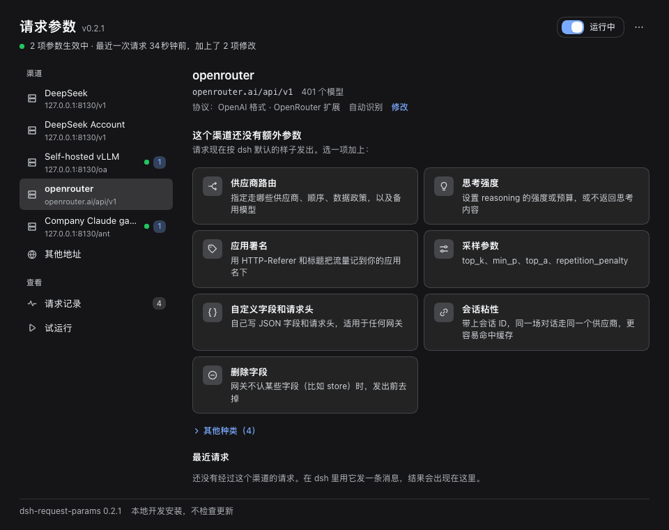
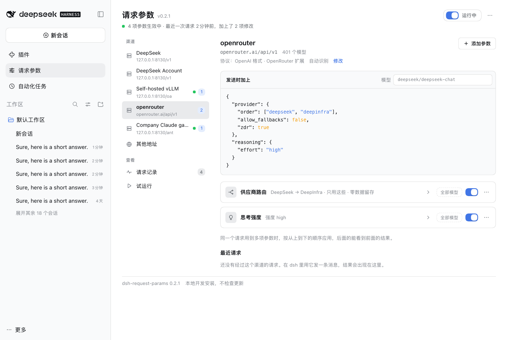
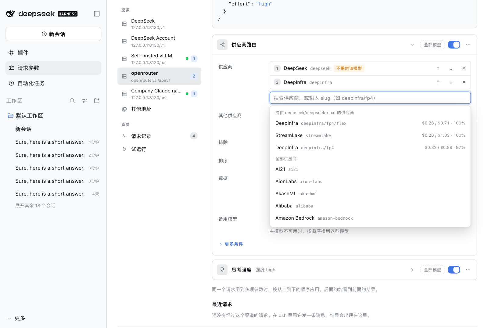
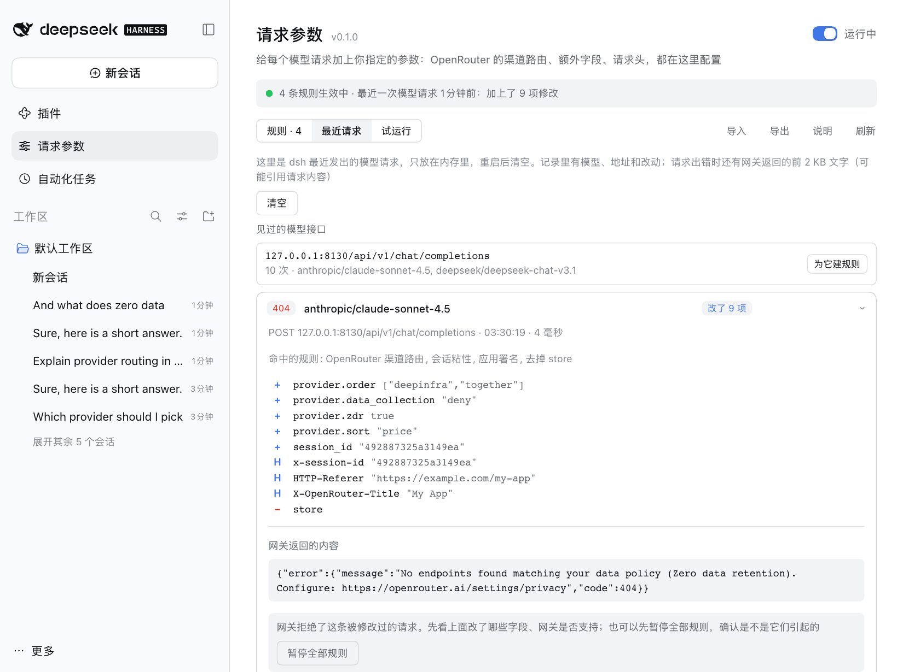
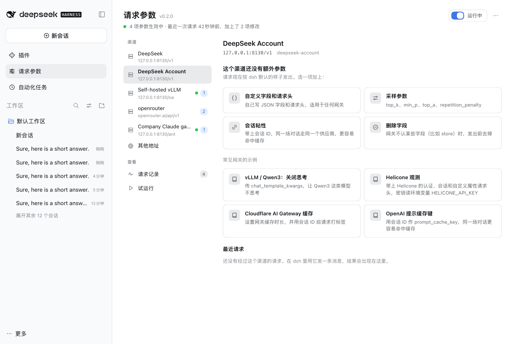
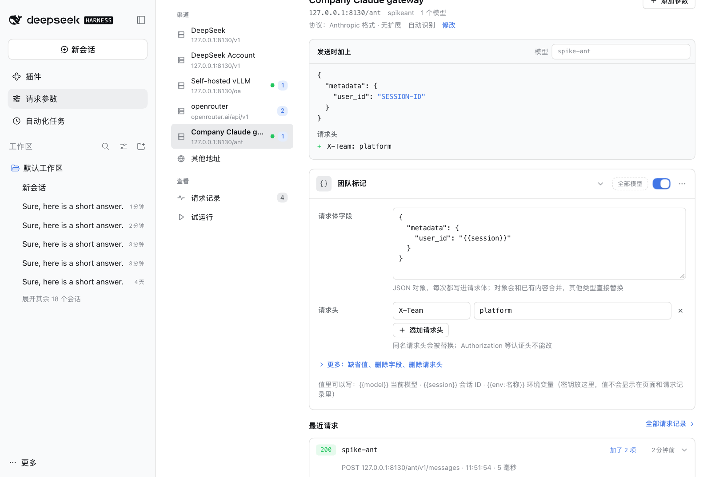

# 请求参数（dsh-request-params）

[English](README.md) | 中文

**给 [dsh](https://github.com/deepseek-ai/deepseek-harness) 发出的每个模型请求，加上你自己的参数。** OpenRouter 的供应商路由、备用模型、思考强度、采样参数、网关请求头，或者任何网关认的 JSON 字段。选一个 dsh 里已经配好的渠道，在页面上加参数，不用改代码；发出之前就能看到每个请求会多出什么；发出之后能看到网关回了什么。

<p align="center">
  
</p>

## 为什么需要它

dsh 只发它的模型适配器认识的字段。而 [OpenRouter](https://openrouter.ai) 这类网关能接受更多：走哪些供应商、什么顺序、备用模型、思考预算、用于缓存亲和的会话 ID。dsh 不会发 OpenRouter 的 `provider` 路由偏好。已经有插件覆盖了其中一小块（比如供应商顺序和量化精度）；这个插件是通用的：同一个页面处理任意网关的任意字段和请求头，OpenRouter 的路由选项有现成表单，还有实时预览和日志。

每一项**参数**属于一个渠道（或者自己写明主机、模型和路径），说明在请求体和请求头里加什么、替换什么、删掉什么。参数在请求离开 dsh 之前生效；在规则文件里，每一项就是一条*规则*。

## 亮点

- **按渠道管理。** 页面列出 dsh 里已经配好的模型渠道（官方 DeepSeek 路线，以及 `llm-pi-ai` 的每条路线）和各自发往的地址。打开一个渠道，就能看到它的参数，点一下就能加，自动对准这个渠道。其他地址的参数放在「**其他地址**」。
- **发出前就知道会发什么。** 「**发送时加上**」用 JSON 显示这个渠道的参数会给所选模型的请求加上什么，包括还没保存的修改。什么都不会发出去。
- **选供应商，不用手写 JSON。** 「**供应商路由**」就是一份列表：搜索供应商（提供正在预览的模型的排在前面，带价格和可用率），排好顺序，决定能不能换用其他供应商，排除一些，排序方式，要求零数据留存，加备用模型；价格上限、量化精度、白名单、速度偏好在「**更多条件**」里。不提供该模型的供应商会被标出来；会导致 "No endpoints found" 失败的组合，保存前就会提醒。
- **发出后看发生了什么。** 每个渠道都列出它的最近请求：状态、加上了什么，网关拒绝时还有它的原话。「**请求记录**」里是 dsh 发出的所有模型请求。
- **默认安全。** 核心字段（`messages`、`tools`、`model` 等）和认证请求头（`Authorization`、`x-api-key` 等）改不了。密钥用环境变量（`{{env:名称}}`），不会显示出来。应用参数时出了问题，请求原样发出，不会失败。
- **常用路线共用一个入口。** 官方 DeepSeek 接口，以及 `llm-pi-ai` 的 OpenAI 兼容和 Anthropic 兼容路线（OpenRouter、自建 vLLM、企业网关）走的是同一个 `fetch` 入口；验证过哪些，见「兼容性与限制」。
- **一键更新。** 插件有新版本时页面会告诉你，确认后用 DSH 自带的安装器装上。
- **日常用着顺手。** 一个开关就能全部暂停；没保存的修改离开页面也不丢，Ctrl/⌘ + S 保存；删除可以撤销；规则文件在别处被改过会被发现，而不是被覆盖；参数可以导出、导入 JSON；中英文界面，浅色深色都有，手机宽度也能用。

<p align="center">
  <picture>
    <source media="(prefers-color-scheme: dark)" srcset="docs/screenshots/overview-dark-zh.png">
    
  </picture>
</p>

<p align="center">
  <picture>
    <source media="(prefers-color-scheme: dark)" srcset="docs/screenshots/routing-dark-zh.png">
    
  </picture>
</p>

## 安装

```bash
dsh plugin --profile web add dsh-request-params
```

从源码运行 dsh 的话用 `pnpm dsh plugin --profile web add dsh-request-params`，然后重启 `dsh web`。侧栏的「插件」下面会出现「请求参数」。

想试本地目录，把名字换成 `link:/path/to/dsh-request-params`。

## 快速上手：两分钟用上 OpenRouter

1. **先让 dsh 走 OpenRouter**（已经配好就跳过）。`llm-pi-ai` 里 `openrouter` 是内置供应商，只要给一个密钥，放在环境变量里：

   ```yaml
   - name: '@deepseek-ai/dsh-llm-pi-ai'
     config:
       providers:
         openrouter:
           apiKeyEnv: OPENROUTER_API_KEY
   ```

   然后在输入框里选一个 OpenRouter 的模型。
2. 打开「请求参数」，选 **openrouter** 渠道。点「**供应商路由**」，输入供应商（例如 `deepseek`）按回车；如果不允许别的供应商接手，把「其他供应商」设成「**不使用**」；点「**保存**」（或 Ctrl/⌘ + S）。「**发送时加上**」会显示 `provider` 对象；在它的「模型」框里填你实际用的模型，如果有供应商被标成「不提供该模型」，换一个供应商或模型。
3. 发一条消息，渠道的「**最近请求**」里会显示加上了什么、网关返回的状态。

<p align="center">
  <picture>
    <source media="(prefers-color-scheme: dark)" srcset="docs/screenshots/requests-dark-zh.png">
    
  </picture>
</p>

## 能加什么

| 种类 | 加的内容 | 典型用途 |
|---|---|---|
| **供应商路由** | `provider`（`order`、`only`、`ignore`、`allow_fallbacks`、`require_parameters`、`data_collection`、`zdr`、`quantizations`、`sort`、`max_price`、`preferred_min_throughput`、`preferred_max_latency`、`enforce_distillable_text`）和 `models` | 选供应商和顺序、限价、要求零数据留存、回退到别的模型 |
| **思考强度** | `reasoning`（`effort`、`max_tokens`、`exclude`） | 调高或调低思考，或者不在回答里返回思考内容 |
| **采样参数** | `top_k`、`min_p`、`top_a`、`repetition_penalty` | 标准接口没有的采样项 |
| **会话粘性** | 请求体里的 `session_id` 和请求头 `x-session-id` | 让同一场对话固定走一个供应商，更容易命中缓存 |
| **应用署名** | `HTTP-Referer` 和 `X-OpenRouter-Title` 请求头 | 在 OpenRouter 上把流量记到你的应用名下（dsh 自己不发这些） |
| **删除字段** | 删掉 `store` 之类的字段 | 网关不认 dsh 发的某个字段 |
| **自定义字段和请求头** | 随便：JSON 字段、请求头、删除 | 其他任何网关 |

OpenRouter 渠道可以加所有种类。其他渠道只列出不限于 OpenRouter 的种类，外加其他网关的示例：自建 vLLM 关闭思考（`chat_template_kwargs`）、Helicone 请求头、Cloudflare AI Gateway 缓存请求头、OpenAI 的 `prompt_cache_key`。其中会往请求体里加字段的两个（vLLM 和 `prompt_cache_key`），在已知发 Anthropic Messages 请求的渠道上不列出，比如官方 DeepSeek 渠道，或 `api` 设为 `anthropic-messages` 的渠道。示例创建出来就是一项普通的自定义参数，随便改。「其他地址」里所有种类都有。

<p align="center">
  <picture>
    <source media="(prefers-color-scheme: dark)" srcset="docs/screenshots/add-dark-zh.png">
    
  </picture>
</p>

## 自己写参数

「自定义字段和请求头」有这些部分：

- **请求体字段**：一个 JSON 对象，合并进请求体。对象和已有内容合并，其他类型直接替换。
- **请求头**：加到请求上，同名的会被替换。
- 「**更多**」里还有：**缺省值**（和请求体字段一样，但请求里已经有的字段不动）、**删除字段**（用点号写路径，如 `store`、`stream_options.include_usage`；先删除，再写入）、**删除请求头**、**允许改核心字段**。

每项参数都有适用范围。在渠道里，「**全部模型**」按钮可以把它限定到这个渠道的部分模型（`deepseek/*`、`*-chat`），菜单里的「编辑主机和路径」显示它匹配的地址。在「其他地址」里，参数自己写明*主机*（`openrouter.ai`、`*.example.com`、`127.0.0.1:8130`）、可选的*模型*、可选的*路径*（前缀）。不写路径时只作用于模型接口（`…/chat/completions`、`…/messages`、`…/responses`、`…:generateContent`）；要用在别的接口，写上路径。

同一个请求用到多项参数时，从上到下执行，靠后的能看到前面的结果。值里可以用 `{{model}}`（请求的模型）、`{{session}}`（dsh 会话 ID；有些路线 dsh 不带会话 ID，就用从对话内容算出的稳定键）、`{{env:名称}}`（环境变量；没设置时这个字段被跳过，日志里会说明）。

<p align="center">
  <picture>
    <source media="(prefers-color-scheme: dark)" srcset="docs/screenshots/custom-dark-zh.png">
    
  </picture>
</p>

## 安全与隐私

- `messages`、`system`、`tools`、`tool_choice`、`input`、`instructions`、`prompt`、`contents`、`stream`、`model` 默认不能设置或删除，除非自定义参数明确允许。
- `Authorization`、`x-api-key`、`api-key`、`x-goog-api-key`、`Cookie`、`Host`，以及决定请求格式的请求头（`Content-Length`、`Content-Type` 等）永远不能改。
- 有问题的参数不会生效，页面会指出哪里不对。发送请求时应用参数出了错，请求原样发出，日志里会写明。
- 参数保存在你本机的 `<profile>/.dsh-request-params/config.json`，不会因此向任何地方发送东西。
- 请求记录只在内存里（最近 50 个请求，重启后清空），包含模型、地址和做过的改动；请求失败时还会留下网关返回内容的前 2 KB，那里面可能引用请求内容。它不保存对话本身。来自环境变量的值显示为「不显示」；如果网关的回复里引用了它，会被替换成 `[env]`。
- 渠道列表来自 dsh 自己的渠道列表和设置（密钥已隐去），用来显示每个渠道的地址和模型；页面不会改动它们，也不保存。
- 页面只为两件事联网。OpenRouter 的公开目录（`/providers`、`/models`、`/models/{id}/endpoints`）只在页面上有供应商路由参数时读取：供应商列表、提供预览模型的供应商、备用模型的候选；供应商列表在离线时用插件自带的一份。检查更新时向 DSH 配置的 npm 源询问这个插件的最新版本（见「更新」）。两者都不带密钥，也不带任何内容。

## 规则文件

页面读写的是 `<profile>/.dsh-request-params/config.json`，也可以手动编辑：下一个模型请求就会用上新规则，打开着的页面几秒内会自动载入（如果页面上有没保存的修改，会先问你怎么处理）。

```json
{
  "version": 1,
  "revision": 3,
  "enabled": true,
  "rules": [
    {
      "id": "r1a2b3c4d",
      "name": "OpenRouter：优先 DeepInfra",
      "enabled": true,
      "match": { "hosts": ["openrouter.ai"], "paths": [], "models": ["deepseek/*"] },
      "body": {
        "merge": { "provider": { "order": ["deepinfra", "together"], "sort": "price" } },
        "defaults": {},
        "remove": ["store"]
      },
      "headers": { "set": { "X-OpenRouter-Title": "My App" }, "remove": [] },
      "allowProtected": false
    }
  ]
}
```

- `revision` 记录保存次数。页面要覆盖更新的版本时会被拦下，让你选择怎么办。
- 规则还可以带 `note`（备注）和 `preset`（`{ "id", "form" }`，页面重新打开的表单）。如果 `preset` 生成的内容和这条规则的 `body`、`headers` 不再一致，`preset` 会被去掉，规则作为自定义规则保留。
- 读文件时，页面不认识的字段、类型不对的值会被丢掉。不是合法 JSON 的文件会在页面上报出来，原样不动；点「移开并重新开始」会把它改名留作备份。
- 「导出」写出的是同样的对象，只是没有 `revision`。「导入」接受这种对象，也接受单独的规则数组。

## 工作原理

dsh 的模型适配器都通过全局 `fetch` 发请求，这个插件包装了一次 `fetch`。对于请求体是 JSON、看起来像模型调用（或被某条规则点名）的 POST 请求，它读出请求体，应用匹配的规则，再发出修改后的请求；其他请求原样通过。响应和流不会被读取或修改（只记录状态，请求失败时记录响应的前 2 KB 给日志用）。卸载插件或者暂停之后，一切回到 dsh 自己发的样子。

## 参数好像没生效？

1. 打开那个渠道。「发送时加上」显示参数会给「模型」框里的模型加上什么。如果它说没有参数作用于这个模型，检查参数的模型范围（「全部模型」按钮）。
2. 看渠道的「最近请求」，或者「请求记录」。如果请求根本不在里面，说明模型请求没有经过 `fetch`（或者重启后还没发过消息）。
3. 展开那条请求。「没有参数」说明主机、模型或路径和所有参数都对不上。主机不写端口就匹配任何端口；只想匹配某个端口，写成 `127.0.0.1:8130`。
4. 「无需修改」说明请求里本来就有那些值。
5. 提示参数「有问题」或「用到没设置的环境变量」的，按提示改。
6. 网关返回 4xx 时展开请求：加了哪些字段、网关原话是什么，都列在里面。点「暂停全部参数」可以确认是不是它们引起的。OpenRouter 返回 "No endpoints found"，通常是你允许的供应商都不提供那个模型；路由表单会按预览的模型把它们标出来。

## 兼容性与限制

- 需要带 Web 界面的 dsh，Node `^22.19.0 || >=24`。在 dsh 0.2.1-rc.2 上测试过。
- 在真实的 dsh 上验证过三条路线：官方 DeepSeek 接口（`/v1/messages`）、`llm-pi-ai` 的 OpenAI 兼容路线（`/chat/completions`）、`llm-pi-ai` 的 Anthropic 兼容路线（`/v1/messages`）。
- 只作用于通过全局 `fetch` 发出的请求。如果某个供应商提前捕获了自己的 `fetch`，就看不到；请求记录显示的就是插件看到的。
- 网关可能忽略或拒绝它不认识的字段。OpenRouter 会忽略不支持的参数，除非打开 `require_parameters`。
- 上限：100 项参数；每项参数的请求体字段和缺省值各 64 KB JSON，请求头 40 个。

## 卸载

```bash
dsh plugin --profile web remove dsh-request-params
```

请求回到 dsh 自己发的样子。参数仍留在 `<profile>/.dsh-request-params/config.json`，重新安装会带回来；想清理就删掉那个文件夹。

## 更新

页面会检查这个插件有没有新版本，并且能直接装上。

- **检查**：打开页面时，插件向 DSH 配置的 npm 源（镜像也可以）询问 `dsh-request-params` 的最新版本，最多 12 小时一次，请求里只有包名。页面底部的「自动检查更新」可以关掉；底部和「⋯」菜单里的「检查更新」仍然可用。本地开发安装（`link:`）不检查。
- **升级**：有新版本时，页面顶部出现提示，带「查看更新记录」和「升级…」。确认后，DSH 自带的安装器从 npm 源下载那个版本的压缩包并安装，显示进度，可以「取消安装」。安装失败或取消时，安装器会把配置文件恢复原样，提示里会给出安装器的原话和手动升级的命令。只提供 `latest` 正式版，不提供预发布版；压缩包地址必须是回答的那个源上这个包的文件。
- **升级之后**：取决于 DSH 版本，新版本要么立即换上（这个页面会关闭，重新打开即可），要么在重启 dsh 后生效（网页版：重新运行 `dsh web`；桌面应用：退出后重新打开）。下次打开页面会显示「已升级到」新版本。你的参数都会保留，正在运行的会话不受影响。提示里会给出退回旧版本的命令。
- **从 GitHub 安装的**：提示里显示 `dsh plugin --profile web add github:xiaohai-78/dsh-request-params`，不显示按钮。
- **手动升级**：运行 `dsh plugin --profile web add dsh-request-params@latest`，或者在「插件」页点「添加插件」，填 `https://registry.npmjs.org/dsh-request-params/-/dsh-request-params-<版本>.tgz`。不带 `@latest` 的命令什么都不做，因为 DSH 会保留已经装好的版本。
- **从 0.1.0 升级**：0.1.0 没有更新检查，需要手动升级一次。

## 开发

| 文件 | 作用 |
|---|---|
| `index.js` | 宿主插件：包装 `fetch`，提供 `POST /api/dsh-request-params`（`get`、`save`、`check`、`dryRun`、`preset`、`recent`、`clearRecent`、`resetDamaged`、`channels`、`orProviders`、`orModels`、`orEndpoints`，以及更新相关的 `updateStatus`、`setUpdateCheck`、`dismissUpgraded`、`upgrade`、`upgradeStatus`、`cancelUpgrade`），规则文件变化时重新加载 |
| `rules.js` | 规则引擎：校验、主机/模型/路径匹配、模板、把规则应用到请求体和请求头 |
| `interceptor.js` | `fetch` 包装和请求日志 |
| `presets.js` | 预设表单，以及它们生成的规则 |
| `config-store.js` | 规则文件：原子写入、版本检查 |
| `channels.js` | 从 dsh 的 `llm` 和 `settings` 服务读取已配置的渠道，算出每个渠道的地址 |
| `update.js` | 不依赖 DSH 服务的版本检查工具：版本比较、配置依赖这个包的方式、要询问的源，以及核对源给的压缩包地址确实是那个源上这个包的文件 |
| `self-update.js` | 更新相关的动作：带 12 小时缓存的检查，`<profile>/.dsh-request-params/settings.json` 里的开关和升级留下的记录，以及通过 DSH 插件管理器安装（`installBundle`、`cancelInstall`、`plugin-manager/install-state` 进度） |
| `openrouter.js` | OpenRouter 目录客户端，带缓存和离线兜底；`openrouter-providers.json` 是自带的供应商列表 |
| `client.js` | 网页（中英文）：渠道列表、预览、参数卡片、请求记录、试运行 |
| `test/` | `node --test` 测试；`test/fixtures/` 里是裁剪过的 OpenRouter 目录返回 |

### 验证

```bash
npm test
```

用 `node --test` 跑 109 个测试：规则引擎、`fetch` 包装（链式安全、字符串/字节/`Request` 三种请求体、错误记录）、预设、规则文件、目录客户端、读取已配置的渠道、宿主的各个动作、页面把参数和请求对应到渠道的逻辑以及预览和概括，检查更新和升级、包里是否带上了代码引用的每个模块，还有页面的中英文文案是否一一对应。页面和这个入口还在真实的 dsh 进程里配合本地模拟模型服务做过端到端检查：上面三条路线、按渠道加参数并在实际发出的请求里看到、预览、供应商搜索和「不提供该模型」提示、保存、暂停、撤销、导入导出、规则文件在别处被改、浅色/深色/窄屏/手机宽度布局。更新在 dsh 0.2.1-rc.2 上对着真实的 npm 源检查过：标成 0.0.9 的副本发现了 0.1.0，「升级…」通过 DSH 的安装器装上了它，配置随后依赖 0.1.0 的压缩包，新版本不用重启就换上了；再装一次同一个版本，会提示已经装好、重启后生效。本文的截图就来自这套环境；里面的 OpenRouter 目录是 OpenRouter 公开的那份，没有向 OpenRouter 发过请求。

## 更新记录

见 [CHANGELOG.md](CHANGELOG.md)。

## 许可

MIT
