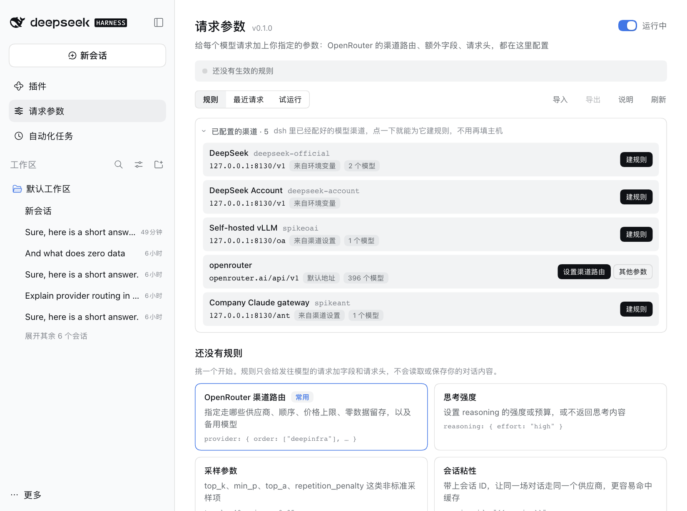

# 请求参数（dsh-request-params）

[English](README.md) | 中文

**给 [dsh](https://github.com/deepseek-ai/deepseek-harness) 发出的每个模型请求，加上你自己的参数。** OpenRouter 的渠道（供应商）路由、备用模型、思考强度、采样参数、网关请求头，或者任何网关认的 JSON 字段。在页面上配置，不用改代码；发出之前先预览会改成什么样；发出之后能看到网关回了什么。

<p align="center">
  
</p>

## 为什么需要它

dsh 只发它的模型适配器认识的字段。而 [OpenRouter](https://openrouter.ai) 这类网关能接受更多：走哪些供应商、什么顺序、备用模型、思考预算、用于缓存亲和的会话 ID。dsh 不会发 OpenRouter 的 `provider` 路由偏好。已经有插件覆盖了其中一小块（比如供应商顺序和量化精度）；这个插件是通用的：同一个页面处理任意网关的任意字段和请求头，OpenRouter 的路由选项有现成表单，还有预览和日志。

一条**规则**说明它管哪些请求（主机、模型、路径），以及在请求体和请求头里加什么、替换什么、删掉什么。规则在请求离开 dsh 之前生效。

## 亮点

- **从已有的渠道开始。** 「**已配置的渠道**」列出 dsh 里已经配好的模型渠道（官方 DeepSeek 路线，以及 `llm-pi-ai` 的每条路线），带每个渠道实际发往的地址和它的模型。点「**建规则**」新建的规则已经指向这个渠道；OpenRouter 渠道还能一键「**设置渠道路由**」。
- **选供应商，不用手写 JSON。** OpenRouter 预设是一张表单：供应商顺序、只用/不用名单、是否允许回退、零数据留存、按价格或速度排序、价格上限、量化精度、备用模型。「**看看这个模型有哪些供应商**」会按模型 ID 列出 OpenRouter 公开目录里的全部供应商，带价格、上下文和可用率，一键加进你的名单。
- **发出前先看会改成什么。** 「**试运行**」用示例请求跑一遍你的规则（包括还没保存的），展示请求体的差异和请求头的变化，什么都不会发出去。
- **发出后看发生了什么。** 「**最近请求**」列出 dsh 发出的每个模型请求：规则有没有改它、设置或删除了哪些字段、HTTP 状态，网关拒绝时还有它的原话。没命中的规则也会告诉你为什么。
- **默认安全。** 核心字段（`messages`、`tools`、`model` 等）和认证请求头（`Authorization`、`x-api-key` 等）改不了。密钥用环境变量（`{{env:名称}}`），不会显示出来。应用规则时出了问题，请求原样发出，不会失败。
- **常用路线共用一个入口。** 官方 DeepSeek 接口，以及 `llm-pi-ai` 的 OpenAI 兼容和 Anthropic 兼容路线（OpenRouter、自建 vLLM、企业网关）走的是同一个 `fetch` 入口；验证过哪些，见「兼容性与限制」。
- **日常用着顺手。** 一个开关就能暂停所有规则；没保存的修改离开页面也不丢；删除规则可以撤销；规则文件在别处被改过会被发现，而不是被覆盖；规则可以导出、导入 JSON；中英文界面，浅色深色都有。

<p align="center">
  <picture>
    <source media="(prefers-color-scheme: dark)" srcset="docs/screenshots/routing-dark-zh.png">
    
  </picture>
</p>

<p align="center">
  <picture>
    <source media="(prefers-color-scheme: dark)" srcset="docs/screenshots/channels-dark-zh.png">
    
  </picture>
</p>

## 安装

```bash
dsh plugin --profile web add dsh-request-params
```

从源码运行 dsh 的话用 `pnpm dsh plugin --profile web add dsh-request-params`，然后重启 `dsh web`。侧栏的「插件」下面会出现「请求参数」。

想试本地目录，把名字换成 `link:/path/to/dsh-request-params`。

## 快速上手：两分钟用上 OpenRouter

1. **先让 dsh 走 OpenRouter**（已经配好就跳过）。`llm-pi-ai` 里 `openrouter` 是内置供应商，只要给一个密钥，放在环境变量里：

   ```yaml
   - name: '@deepseek-ai/dsh-llm-pi-ai'
     config:
       providers:
         openrouter:
           apiKeyEnv: OPENROUTER_API_KEY
   ```

   然后在输入框里选一个 OpenRouter 的模型。
2. 打开「请求参数」，在「已配置的渠道」里点 OpenRouter 渠道的「**设置渠道路由**」（或者点下面的「OpenRouter 渠道路由」，主机保留 `openrouter.ai`），在「优先顺序」里输入供应商，例如 `deepinfra`（或者展开「看看这个模型有哪些供应商」，点「加入顺序」），「排序」选「价格」，点「**保存**」。
3. 发一条消息，打开「最近请求」，就能看到发出去的 `provider` 对象。

<p align="center">
  <picture>
    <source media="(prefers-color-scheme: dark)" srcset="docs/screenshots/requests-dark-zh.png">
    
  </picture>
</p>

## 能加什么

| 预设 | 加的内容 | 典型用途 |
|---|---|---|
| **OpenRouter 渠道路由** | `provider`（`order`、`only`、`ignore`、`allow_fallbacks`、`require_parameters`、`data_collection`、`zdr`、`quantizations`、`sort`、`max_price`、`preferred_min_throughput`、`preferred_max_latency`、`enforce_distillable_text`）和 `models` | 选供应商和顺序、限价、要求零数据留存、回退到别的模型 |
| **思考强度** | `reasoning`（`effort`、`max_tokens`、`exclude`） | 调高或调低思考，或者不在回答里返回思考内容 |
| **采样参数** | `top_k`、`min_p`、`top_a`、`repetition_penalty` | 标准接口没有的采样项 |
| **会话粘性** | 请求体里的 `session_id` 和请求头 `x-session-id` | 让同一场对话固定走一个供应商，更容易命中缓存 |
| **应用署名** | `HTTP-Referer` 和 `X-OpenRouter-Title` 请求头 | 在 OpenRouter 上把流量记到你的应用名下（dsh 自己不发这些） |
| **删除字段** | 删掉 `store` 之类的字段 | 网关不认 dsh 发的某个字段 |
| **自定义规则** | 随便：JSON 字段、请求头、删除 | 其他任何网关 |

「新建规则」里还有其他网关的示例，一键创建：自建 vLLM 关闭思考（`chat_template_kwargs`）、Helicone 请求头、Cloudflare AI Gateway 缓存请求头、OpenAI 的 `prompt_cache_key`。创建出来就是一条普通的自定义规则，随便改。

## 自己写规则

一条自定义规则有这些部分：

- **适用于**：*主机*（必填，如 `openrouter.ai`、`*.example.com`、`127.0.0.1:8130`），可选的*模型*（`deepseek/*`、`*-chat`），可选的*路径*（前缀）。不写路径时，规则只作用于模型接口（`…/chat/completions`、`…/messages`、`…/responses`、`…:generateContent`）；要用在别的接口，写上路径。
- **总是设置的字段**：一个 JSON 对象，合并进请求体。对象和已有内容合并，其他类型直接替换。
- **缺少时才设置的字段**：同上，但请求里已经有的字段不动。
- **要删除的字段**：用点号写路径，如 `store`、`stream_options.include_usage`。先删除，再设置。
- **请求头**：要加的（同名的会被替换）和要去掉的。

规则从上到下执行，靠后的能看到前面的结果。值里可以用 `{{model}}`（请求的模型）、`{{session}}`（dsh 会话 ID；有些路线 dsh 不带会话 ID，就用从对话内容算出的稳定键）、`{{env:名称}}`（环境变量；没设置时这个字段被跳过，日志里会说明）。

## 安全与隐私

- `messages`、`system`、`tools`、`tool_choice`、`input`、`instructions`、`prompt`、`contents`、`stream`、`model` 默认不能设置或删除，除非自定义规则明确允许。
- `Authorization`、`x-api-key`、`api-key`、`x-goog-api-key`、`Cookie`、`Host`，以及决定请求格式的请求头（`Content-Length`、`Content-Type` 等）永远不能改。
- 有问题的规则不会生效，页面会指出哪里不对。发送请求时应用规则出了错，请求原样发出，日志里会写明。
- 规则保存在你本机的 `<profile>/.dsh-request-params/config.json`，不会因此向任何地方发送东西。
- 「**最近请求**」只在内存里（最近 50 个请求，重启后清空），包含模型、地址和做过的改动；请求失败时还会留下网关返回内容的前 2 KB，那里面可能引用请求内容。它不保存对话本身。来自环境变量的值显示为「不显示」；如果网关的回复里引用了它，会被替换成 `[env]`。
- 「已配置的渠道」读取 dsh 自己的渠道列表和设置（密钥已隐去），用来显示每个渠道的地址和模型；不会改动它们，也不保存。
- 唯一会联网的是「看看这个模型有哪些供应商」，它读取 OpenRouter 的公开目录（`/providers`、`/models`、`/models/{id}/endpoints`），不带密钥也不带内容；供应商列表在离线时用插件自带的一份。

## 规则文件

页面读写的是 `<profile>/.dsh-request-params/config.json`，也可以手动编辑：下一个模型请求就会用上新规则，打开着的页面几秒内会自动载入（如果页面上有没保存的修改，会先问你怎么处理）。

```json
{
  "version": 1,
  "revision": 3,
  "enabled": true,
  "rules": [
    {
      "id": "r1a2b3c4d",
      "name": "OpenRouter：优先 DeepInfra",
      "enabled": true,
      "match": { "hosts": ["openrouter.ai"], "paths": [], "models": ["deepseek/*"] },
      "body": {
        "merge": { "provider": { "order": ["deepinfra", "together"], "sort": "price" } },
        "defaults": {},
        "remove": ["store"]
      },
      "headers": { "set": { "X-OpenRouter-Title": "My App" }, "remove": [] },
      "allowProtected": false
    }
  ]
}
```

- `revision` 记录保存次数。页面要覆盖更新的版本时会被拦下，让你选择怎么办。
- 规则还可以带 `note`（备注）和 `preset`（`{ "id", "form" }`，页面重新打开的表单）。如果 `preset` 生成的内容和这条规则的 `body`、`headers` 不再一致，`preset` 会被去掉，规则作为自定义规则保留。
- 读文件时，页面不认识的字段、类型不对的值会被丢掉。不是合法 JSON 的文件会在页面上报出来，原样不动；点「移开并重新开始」会把它改名留作备份。
- 「导出」写出的是同样的对象，只是没有 `revision`。「导入」接受这种对象，也接受单独的规则数组。

## 工作原理

dsh 的模型适配器都通过全局 `fetch` 发请求，这个插件包装了一次 `fetch`。对于请求体是 JSON、看起来像模型调用（或被某条规则点名）的 POST 请求，它读出请求体，应用匹配的规则，再发出修改后的请求；其他请求原样通过。响应和流不会被读取或修改（只记录状态，请求失败时记录响应的前 2 KB 给日志用）。卸载插件或者暂停之后，一切回到 dsh 自己发的样子。

## 规则好像没生效？

1. 打开「最近请求」。如果请求根本不在里面，说明模型请求没有经过 `fetch`（或者重启后还没发过消息）。
2. 展开那条请求。「没有规则命中」说明主机、模型或路径对不上：和规则的「适用于」对一对。主机不写端口就匹配任何端口；只想匹配某个端口，写成 `127.0.0.1:8130`。
3. 「命中，无需修改」说明请求里本来就有那些值。
4. 提示规则「有问题」或「用到没设置的环境变量」的，按提示改。
5. 网关返回 4xx 时展开请求：加了哪些字段、网关原话是什么，都列在里面。点「暂停全部规则」可以确认是不是它们引起的。

## 兼容性与限制

- 需要带 Web 界面的 dsh，Node `^22.19.0 || >=24`。在 dsh 0.2.1-rc.2 上测试过。
- 在真实的 dsh 上验证过三条路线：官方 DeepSeek 接口（`/v1/messages`）、`llm-pi-ai` 的 OpenAI 兼容路线（`/chat/completions`）、`llm-pi-ai` 的 Anthropic 兼容路线（`/v1/messages`）。
- 只作用于通过全局 `fetch` 发出的请求。如果某个供应商提前捕获了自己的 `fetch`，就看不到；「最近请求」显示的就是插件看到的。
- 网关可能忽略或拒绝它不认识的字段。OpenRouter 会忽略不支持的参数，除非打开 `require_parameters`。
- 上限：100 条规则；每条规则里「总是设置」和「缺少时才设置」各 64 KB JSON，请求头 40 个。

## 卸载

```bash
dsh plugin --profile web remove dsh-request-params
```

请求回到 dsh 自己发的样子。规则仍留在 `<profile>/.dsh-request-params/config.json`，重新安装会带回来；想清理就删掉那个文件夹。

## 开发

| 文件 | 作用 |
|---|---|
| `index.js` | 宿主插件：包装 `fetch`，提供 `POST /api/dsh-request-params`（`get`、`save`、`check`、`dryRun`、`preset`、`recent`、`clearRecent`、`resetDamaged`、`orProviders`、`orModels`、`orEndpoints`），规则文件变化时重新加载 |
| `rules.js` | 规则引擎：校验、主机/模型/路径匹配、模板、把规则应用到请求体和请求头 |
| `interceptor.js` | `fetch` 包装和请求日志 |
| `presets.js` | 预设表单，以及它们生成的规则 |
| `config-store.js` | 规则文件：原子写入、版本检查 |
| `channels.js` | 从 dsh 的 `llm` 和 `settings` 服务读取已配置的渠道，算出每个渠道的地址 |
| `openrouter.js` | OpenRouter 目录客户端，带缓存和离线兜底；`openrouter-providers.json` 是自带的供应商列表 |
| `client.js` | 网页（中英文） |
| `test/` | `node --test` 测试；`test/fixtures/` 里是裁剪过的 OpenRouter 目录返回 |

### 验证

```bash
npm test
```

用 `node --test` 跑 80 个测试：规则引擎、`fetch` 包装（链式安全、字符串/字节/`Request` 三种请求体、错误记录）、预设、规则文件、目录客户端、读取已配置的渠道、宿主的各个动作，以及页面的中英文文案是否一一对应。页面和这个入口还在真实的 dsh 进程里配合本地模拟模型服务做过端到端检查：上面三条路线、保存、暂停、撤销、导入导出、规则文件在别处被改、浅色/深色/窄屏布局。本文的截图就来自这套环境，用本地模拟服务代替 OpenRouter。

## 更新记录

见 [CHANGELOG.md](CHANGELOG.md)。

## 许可

MIT
